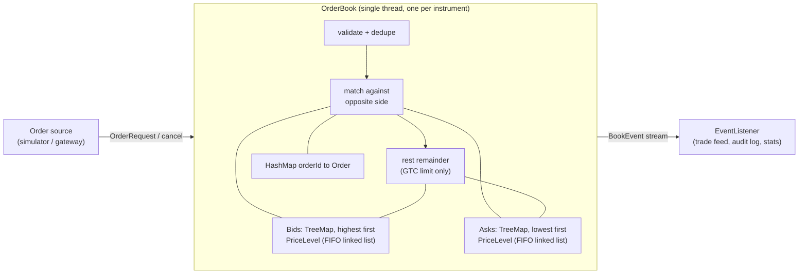

# Order Matching Engine

[](https://github.com/praneetkamble/order-matching-engine/actions/workflows/ci.yml)


A limit order book and matching engine in plain Java 21 with **zero runtime dependencies**. It implements strict
**price-time priority**, limit / market / cancel orders with GTC, IOC and FOK time-in-force, emits an ordered stream
of trade events, ships with a deterministic order-flow simulator, and includes JMH micro-benchmarks.

## Features

- **Price-time priority**: better prices match first; within a price, the earliest order wins. A partially filled
  resting order keeps its place in the queue.
- **Maker-price execution**: trades print at the resting order's price, so aggressive orders get price improvement.
- **Order types**: limit (GTC / IOC / FOK), market (immediate-or-cancel) and cancel.
- **Typed event stream**: a sealed `BookEvent` hierarchy (`OrderAccepted`, `OrderRejected`, `TradeExecuted`,
  `OrderCancelled`) with a gap-free, monotonically increasing sequence number, so a consumer can replay or audit it.
- **Rejects instead of exceptions** for bad input (non-positive quantity or price, duplicate ids, unknown cancels).
- **Exact arithmetic**: prices are `long` ticks and quantities `long` lots. No floating point in the matching path.
- **Deterministic simulator**: a seeded order-flow generator (limit, market, cancels) with a CLI.
- **JMH benchmarks** in a separate module.
- **Strong tests**: scenario tests per rule, a differential test against a naive reference matcher on random flow,
  and a quantity-conservation invariant.

## Architecture



| Package | Responsibility |
|---|---|
| `model` | `OrderRequest`, `Side`, `OrderType`, `TimeInForce` |
| `book` | `OrderBook` (matching), `PriceLevel` (FIFO queue at one price), `Order`, `LevelSnapshot` |
| `event` | `BookEvent` records, `EventListener`, reject / cancel reasons |
| `sim` | Seeded `Simulator` and its CLI |

## Quick start

```bash
mvn verify                      # build + run all tests
java -jar engine/target/matching-engine-1.0.0.jar --orders 5000000 --seed 42
```

Example simulator output (8 cores, JDK 21, one run):

```
Orders submitted : 3,748,747
Cancels          : 1,251,253 requested, 733,911 succeeded
Trades           : 1,764,328 (45,043,541 lots)
Rejects          : 0
Resting orders   : 1,232,119
Top of book      : bid 9959 / ask 9964 (last trade 9959)
Elapsed          : 1721.9 ms (2,903,702 actions/s)
```

Running the same seed always yields identical trades; only the elapsed time varies.

## Using it as a library

```java
OrderBook book = new OrderBook("ACME", System.out::println);

book.submit(OrderRequest.limit(1, Side.SELL, 10_050, 100));
book.submit(OrderRequest.limit(2, Side.SELL, 10_050, 50));
book.submit(OrderRequest.limit(3, Side.SELL, 10_060, 200));
book.submit(OrderRequest.limit(4, Side.BUY, 10_040, 80));

// A buy that crosses the spread: takes 100 from order 1, then 20 from order 2
book.submit(OrderRequest.limit(5, Side.BUY, 10_055, 120));

System.out.println(book.render(5));
book.cancel(4);                                      // true if the order was resting
book.submit(OrderRequest.market(6, Side.SELL, 25));  // sells into whatever bids exist
book.submit(OrderRequest.limit(7, Side.BUY, 10_050, 500, TimeInForce.FOK)); // all or nothing
```

Output of the first part:

```
OrderAccepted[sequence=5, orderId=5, side=BUY, type=LIMIT, price=10055, quantity=120]
TradeExecuted[sequence=6, tradeId=1, takerOrderId=5, makerOrderId=1, takerSide=BUY, price=10050, quantity=100]
TradeExecuted[sequence=7, tradeId=2, takerOrderId=5, makerOrderId=2, takerSide=BUY, price=10050, quantity=20]
ACME
  ASK      10060  x 200      (1 orders)
  ASK      10050  x 30       (1 orders)
  ----------
  BID      10040  x 80       (1 orders)
```

The buyer was willing to pay up to 10055 but traded at the resting 10050, and order 2 keeps its remaining 30 lots at
the front of that level.

### Order semantics

| Order | Behaviour |
|---|---|
| Limit GTC | Matches what crosses, rests the remainder |
| Limit IOC | Matches what crosses, cancels the remainder (`IOC_REMAINDER`) |
| Limit FOK | Executes completely or not at all (`FOK_UNFILLABLE`, book untouched) |
| Market | Matches at any price, cancels the unfilled remainder (`NO_LIQUIDITY`) |
| Cancel | Removes a resting order and reports its remaining quantity (`USER_REQUESTED`) |

## Benchmarks

```bash
mvn -DskipTests package
java -jar benchmarks/target/benchmarks.jar                 # full run
java -jar benchmarks/target/benchmarks.jar -f 1 -wi 2 -i 3 -w 1 -r 1   # quick run
```

Every benchmark starts from a pre-populated book (100 price levels per side, 50 orders each) and keeps it at a
stable size by replenishing whatever it consumes.

| Benchmark | What it measures | Quick-run result |
|---|---|---|
| `restAndCancel` | Rest a passive order and cancel it | ~89 ns/op |
| `matchSingleFill` | An aggressive order fully filling one resting order, then replenish | ~73 ns/op |
| `sweepFiveLevels` | A market order sweeping 5 levels / 250 resting orders | ~15 µs/op (~60 ns per fill) |
| `mixedFlow` | 60% passive+cancel, 30% aggressive limit, 10% market | ~125 ns/op |

These come from a short run (1 fork, 3 measurement iterations) on a shared 8-core cloud VM, so treat the numbers
as ballpark; the error bars are wide. Use the default settings for anything you intend to quote.

## Design decisions

- **Single-threaded book.** A matching engine's correctness is about a total order of events. One writer thread per
  instrument removes locks and memory-ordering risk, and is how exchanges typically scale (shard by instrument).
  Feed the book from a queue.
- **`TreeMap` of price levels + intrusive FIFO list per level.** The `TreeMap` gives ordered best-price access in
  O(log P); each level is a doubly linked list of orders so that cancel from the middle of a queue is O(1), and
  `HashMap<orderId, Order>` finds the order in O(1).
- **Integer ticks and lots.** Avoids floating-point drift entirely; price conversion belongs at the edge of the system.
- **Events, not callbacks into domain objects.** Every state change is an immutable record with a sequence number. The
  book's state is a pure function of the input stream, which makes it replayable and easy to test.
- **Rejections are events.** Bad input is an expected condition in a trading system, not an exceptional one.
- **FOK pre-check.** FOK orders walk the opposite side to check total fillable quantity before touching the book, so
  a killed order leaves no side effects.
- **Test oracle.** The differential test compares the optimized book fill-by-fill with a deliberately naive matcher
  (flat list, re-sorted each time) over thousands of random operations, including IOC/FOK, duplicates and invalid input.

## Tech stack

Java 21 (records, sealed interfaces, pattern matching) · Maven multi-module · JUnit 5 · AssertJ · JMH 1.37 ·
GitHub Actions

## License

[MIT](LICENSE)
